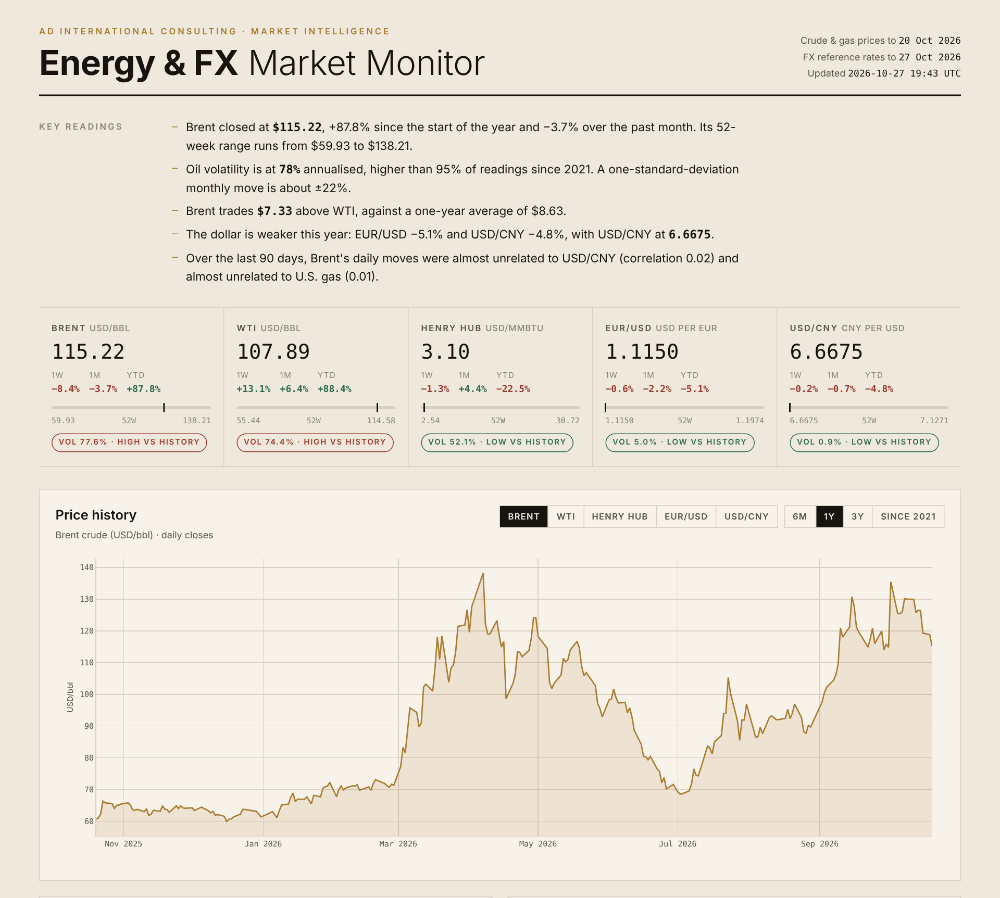

# Energy & FX Market Monitor

A self-updating dashboard tracking crude oil, natural gas and the exchange rates that matter for energy trade between the United States, Europe and China.

**Live dashboard:** https://adupassieux-arch.github.io/energy-fx-monitor/

Built by **Aurélie Dupassieux**, AD International Consulting.



## What it shows

| Section | Content |
|---|---|
| Key readings | Five plain-language findings, regenerated from the data at every update |
| Latest values | Brent, WTI, Henry Hub, EUR/USD, USD/CNY: last price, 1-week / 1-month / year-to-date change, 52-week range, volatility regime |
| Price history | Daily closes since 2021 for each market |
| Brent–WTI spread | Transatlantic crude spread against its one-year average |
| Realised volatility | 30-day annualised volatility, log scale |
| Correlations | 90-day and full-period correlation matrix of daily returns, plus rolling 90-day correlations |
| One-month range | 80% and 95% bands for Brent, EUR/USD and USD/CNY, with a three-year backtest of their accuracy |

## Data

| Series | Source |
|---|---|
| Brent spot (DCOILBRENTEU), WTI spot (DCOILWTICO), Henry Hub spot (DHHNGSP) | U.S. EIA via FRED, Federal Reserve Bank of St. Louis |
| EUR/USD, USD/CNY | European Central Bank euro reference rates (USD/CNY derived from CNY/EUR and USD/EUR) |

All sources are public and need no API key.

## Method

- **Returns:** daily log returns, each market on its own trading calendar; cross-market statistics use days where all five markets published.
- **Volatility:** standard deviation of daily log returns over 30 days × √252. The regime label compares today's reading with its own history since 2021 (top or bottom 20%).
- **One-month range:** driftless log random walk. The central line is today's price; bands use the last 60 days of volatility. Market prices are close to unpredictable at a one-month horizon, so the model makes no directional call. Its value is in the width of the band.
- **Backtest:** every week over the last three years, the band built that day is compared with the price 20 trading days later. Over the latest run, the 80% band contained the outcome about 79% of the time for Brent, EUR/USD and USD/CNY, so the bands are well calibrated.

## How it updates

A GitHub Actions workflow (`.github/workflows/update.yml`) runs every Monday morning: it downloads the data, recomputes the analytics, rebuilds `index.html` and commits the result. GitHub Pages then serves the new version. The workflow can also be started by hand from the **Actions** tab.

## Project structure

```
fetch_and_analyze.py   download, clean and analyse → data/data.json
build_dashboard.py     inject the data into template.html → index.html
template.html          dashboard layout, styles and charts (Plotly.js)
data/data.json         latest computed data
index.html             published page
```

## Run locally

```bash
pip install -r requirements.txt
python fetch_and_analyze.py
python build_dashboard.py
open index.html
```

## Skills demonstrated

Python (pandas, NumPy), API data collection, time-series analysis, volatility and correlation modelling, forecast evaluation, data visualisation (Plotly.js), automation with GitHub Actions, and domain knowledge of commodity and FX markets.

---

For information only. Not investment advice.
